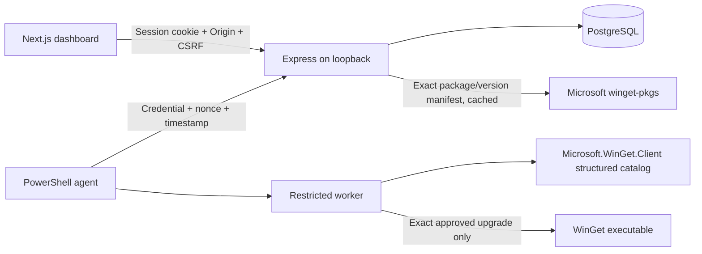

# Architecture

The frontend is Next.js App Router and React/TypeScript, styled with Tailwind v4 and CSS design tokens. Radix Dialog provides focus-trapped, keyboard-accessible confirmations; React Hook Form/Zod validates sign-in; Recharts visualizes actual job activity. The navigation covers overview, inventory/details, updates, security coverage, history and settings. Browser requests use a same-origin `/api` Node.js Route Handler to Express. On Vercel, server-side `API_URL` must identify a separately deployed HTTPS backend. Local operation defaults to loopback. See [deployment settings](DEPLOYMENT.md).

Express runs separately on loopback by default; hosted operation explicitly selects `HOST=0.0.0.0`, production mode and an exact HTTPS browser origin behind the provider's TLS ingress. Zod validates API contracts. PostgreSQL/Prisma is the only runtime state store: no fake in-memory inventory or seed records are used in the real workspace. Jobs use PostgreSQL transactions, row locks and a partial unique index instead of requiring Redis. The PowerShell foreground agent polls, claims a job once and runs a separate worker so progress heartbeats continue while WinGet is busy. Cloud transport remains outbound HTTPS polling from Windows; the backend never connects to a private computer.

## Scan lifecycle

An authenticated owner queues a scan against a ready online device. Only one active operation can exist per device. The agent atomically claims a job and receives an unguessable execution lease. Progress renews the 90-second lease. The worker validates the official source and reads structured catalog objects. The completed result atomically replaces current presence flags, upserts applications and stores immutable scan snapshots. A failed scan preserves the previous inventory. Applications absent from a later scan remain in historical relationships but are hidden from current inventory.

## Approval and update lifecycle

Preview is an ephemeral review stage; it issues a five-minute, one-use approval bound to the user, application, exact from/target versions and observation timestamp. Execution requires `confirm: true`, the session's CSRF secret, ownership, an online ready agent and a scan less than 30 minutes old. A device row lock serializes approval consumption, claims and inventory writes; the database prevents duplicate active operations.

Persisted states are `QUEUED → RUNNING → VERIFYING → COMPLETED`. Alternative terminal states are `FAILED`, `CANCELLED`, `INTERRUPTED`, `RESTART_REQUIRED`, and `VERIFICATION_FAILED`. Preview/awaiting confirmation are UI stages, not invented installer progress. No percentage progress is displayed.

Before installation, the agent rechecks the source, exact identity, installed version and target availability. It passes a fixed argument array to WinGet, without constructing shell commands. Afterward it reads the installed version again (up to three short verification observations, not three installation attempts). The API computes the outcome. Only exit code zero plus an exact changed target observation in verification phase can be `COMPLETED`.

An expired lease is never requeued. The maintenance process marks it interrupted and invalidates the application's prior update eligibility. A fresh scan and new approval are required. Reconnecting cannot replay a terminal job. A hanging installer can outlive its worker, so actual installer termination/rollback is never implied.

## Boundaries

This MVP manages WinGet-correlated applications and one interactive Windows user context per agent. No fleet discovery, automatic scans, bulk execution or vulnerability matching is provided. Hosted deployment configuration is supplied, with account setup and live acceptance still required. A verified source manifest is useful release metadata, not proof of publisher security. The local operating-system user, project source, WinGet installation and PostgreSQL operator are trusted; malware running as the same user is outside this MVP threat boundary.
